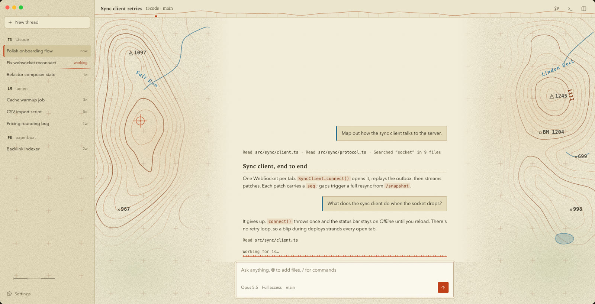

# Contour

**A topographic survey theme for [T3 Code](https://t3.codes).** Light, warm field-sheet paper with sienna contour lines. While your agent works, the contours in the margins shift elevation. When the turn ends, a survey pin is driven into the summit and everything holds still.

**[See it in motion →](https://joshsaintjacque.github.io/t3code-theme-contour/)**



## Install

**From the app**

1. Download [`contour.json`](contour.json), or copy its contents.
2. In T3 Code, open **Settings › Appearance › Add theme**.
3. Choose the file, or paste the JSON, and add it.

**From the terminal**

```sh
curl -fsSL -o contour.json https://joshsaintjacque.github.io/t3code-theme-contour/contour.json
~/.t3/bin/t3 theme set contour.json
```

`t3 theme set` publishes the file and sets it as the environment theme, so every client connected to that environment switches to it.

Tested on T3 Code v0.1.11 (nightly).

## What moves, and when

Every animation is tied to real app state. If nothing is running, nothing moves.

| State | What you see |
|---|---|
| **Idle** | A still map. A survey pin is planted on the summit. |
| **Turn running** | The contours shift elevation: three frames of one terrain, each a third of an interval higher, are held in turn (about 3 seconds each) on a 15 second cycle; the two gutter layers dim to 60% while they step, so labels never double up. Streams, marks and names stay put. |
| **Turn running** | The pin lifts away and an orange reticle marks the summit. A survey stake walks the elevation profile along the header. The live *Working…* row gets hachure ticks. |
| **Another thread busy** | An orange survey line sweeps along the foot of its sidebar row. |
| **Turn complete** | The pin drops, bounces and lands, with a ripple ring. Plays only when a turn ends. |
| **Hover a thread** | Static contour rings fade in from the row's right edge. |
| **Composer focus** | The double neatline turns survey orange. |
| **Narrow windows** | Under 1460px the margins keep soft, label-free contour lines and the scale strip in the sidebar foot becomes a small map strip (pin at rest, reticle while working). |

`prefers-reduced-motion` stops every animation and transition, in the theme and in the SVGs. The still is the idle sheet; while a turn runs it shows the reticle (no pin) and busy rows keep a parked survey line, so state is still readable.

## Palette

Paper is the field sheet, ink is the pencil, and orange is saved for focus, send and work in progress.

| Role | Hex |
|---|---|
| Canvas | `#F3EDDA` |
| Sidebar | `#E7DEC2` |
| Message | `#E6DCBD` |
| Code | `#EBE3C9` |
| Text | `#2B2519` |
| Muted | `#61563F` |
| Accent | `#C0401A` |
| Update | `#2F7396` |
| Border | `#CDBF9A` |
| Error | `#B3261E` |
| Warning | `#A86A08` |

Text on canvas is 12.98:1, muted text 6.16:1, and accent-foreground on accent 4.99:1.

## How the map is made

The terrain is procedural. `source/build.py` sums a handful of Gaussian peaks and some low-frequency wobble into a height field, contours it with marching squares, smooths the lines into quadratic curves, labels every fifth line with its elevation, and traces the streams by steepest descent. The output is a pair of inline SVG data URIs inside `contour.json`; nothing is fetched at runtime.

## Make your own variant

`contour.json` is generated. Edit [`source/build.py`](source/build.py) and run it:

```sh
python3 source/build.py   # writes contour.json, assets/svg/* and index.html
```

Not affiliated with or endorsed by T3. MIT licensed.
